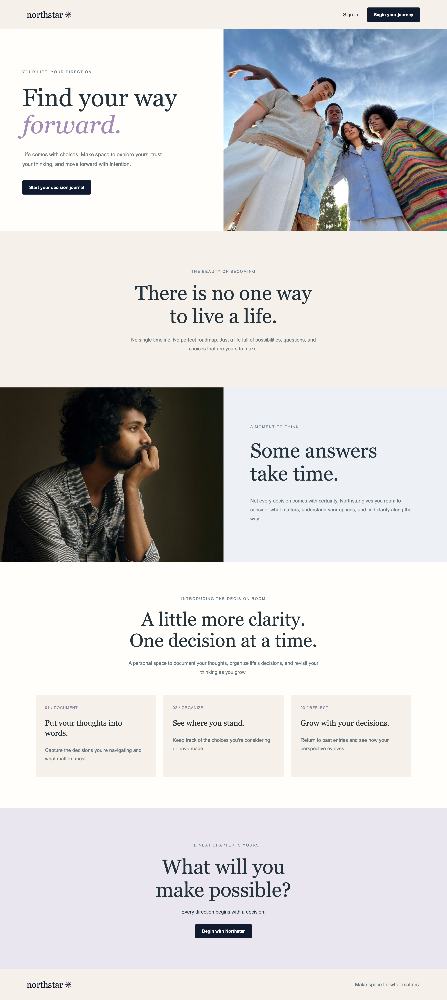
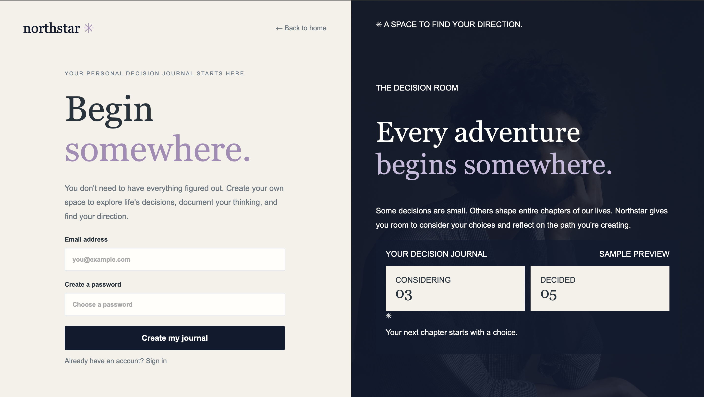
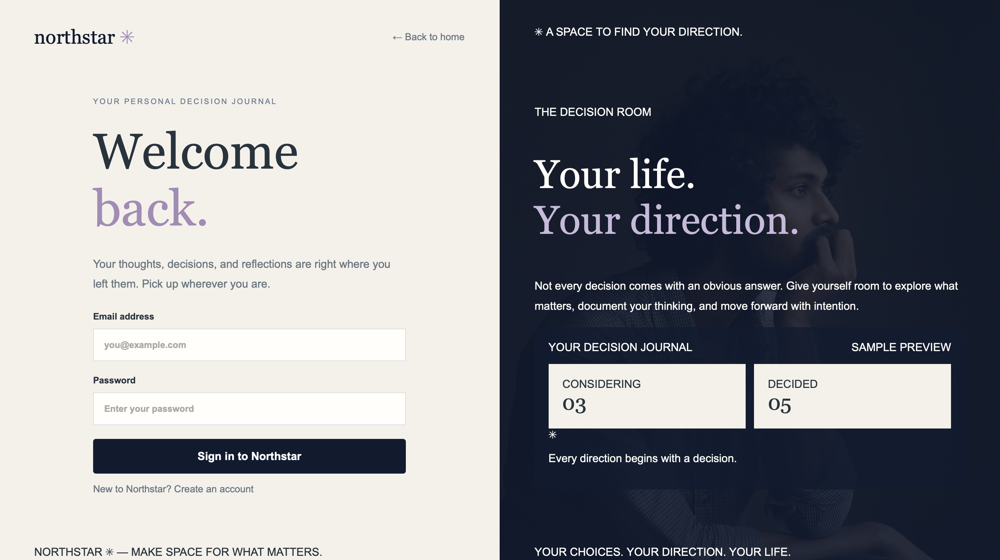
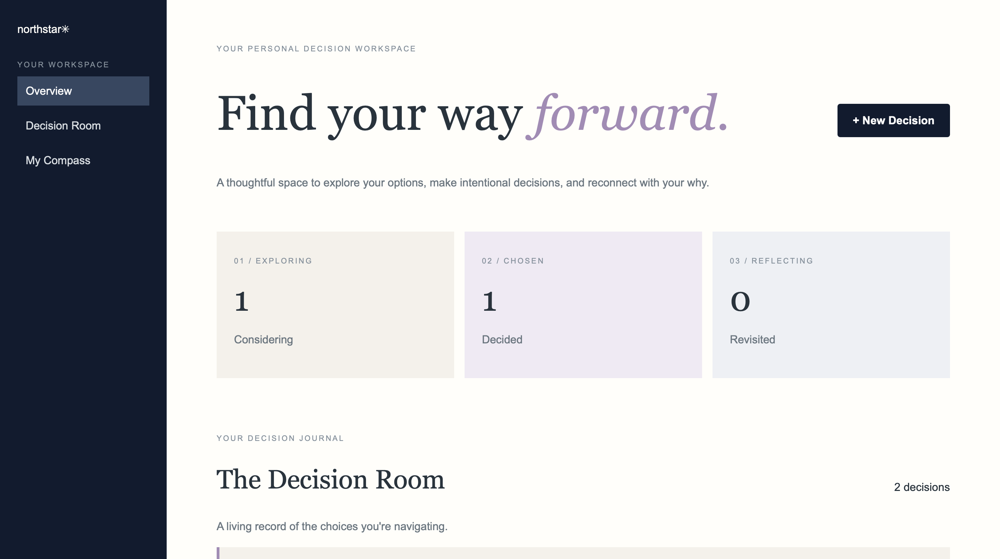

# Northstar™

**A personal decision journal for navigating life's possibilities with greater intention.**

Northstar is a full-stack web application designed to help people reflect on meaningful decisions, explore their possibilities, and move forward with greater clarity.

Not every decision comes with an obvious answer. Whether someone is considering a career change, a new opportunity, a major life transition, or a personal goal, Northstar provides a dedicated space to help them slow down, organize their thinking, and document the decisions shaping their next chapter.

**The idea is simple: Make space for reflection before choosing a direction.**

## Screenshots

### Landing Page



### Sign Up



### Login



### Personal Dashboard



## Features

- **User authentication:** Create an account, sign in, and log out.
- **Personalized dashboard:** Access a private workspace for managing personal decisions.
- **Decision journaling:** Record meaningful decisions and revisit them over time.
- **Decision management:** Create, view, edit, and delete saved entries.
- **Reflection:** Use a dedicated space to consider your thinking and document what matters.
- **Dashboard overview:** See summary statistics alongside your saved decisions.
- **My Compass:** Find a moment of encouragement and perspective within the dashboard.
- **Persistent storage:** Save decision entries in MongoDB so they remain available across sessions.
- **Responsive interface:** Navigate the application across desktop, tablet, and mobile screen sizes.

## Tech Stack

**Frontend**
- HTML
- CSS
- JavaScript
- EJS

**Backend**
- Node.js
- Express.js
- Passport.js

**Database**
- MongoDB Atlas

## Getting Started

### 1. Clone the repository

Clone Northstar from GitHub and open the project directory.

### 2. Install dependencies

```bash
npm install
```

### 3. Configure environment variables

Create a `.env` file in the project's root directory and configure the environment variables required by the application.

For example:

```env
MONGODB_URI=your_mongodb_connection_string
SESSION_SECRET=your_session_secret
```

Replace the placeholder values with your own configuration. Confirm that the variable names match those used in the application before running it.

**Important:** Never commit your `.env` file or expose database credentials or session secrets.

### 4. Start the application

```bash
node server.js
```

### 5. Open the application

Visit `http://localhost:8080` in your browser.

## Live Application

*Deployment forthcoming*

## Product Vision

### A Space Between Possibility and Decision

Life presents us with countless decisions, some relatively small and others capable of changing our trajectory entirely.

Yet meaningful decisions are rarely made in isolation. They are shaped by our aspirations, circumstances, priorities, emotions, relationships, and the possibilities we can imagine for ourselves.

Northstar is built around the belief that thoughtful decision-making deserves more than a fleeting thought, an unfinished note, or a conversation we never revisit.

The application seeks to offer a more intentional environment for navigating uncertainty, one where users can explore their options, reflect on what matters, and approach their next steps with greater awareness and agency.

Rather than telling people what to do, **Northstar is designed to help them think through what they want to do, and why.**

## Current MVP

The initial version focuses on establishing the foundational experience of a personal decision journal.

**Implemented capabilities include:**

- Account registration, login, and logout.
- Authenticated, user-specific dashboards.
- Decision entry creation, viewing, editing, and deletion.
- Persistent storage with MongoDB Atlas.
- Dashboard statistics and a dedicated reflection experience.
- Session-based access protection.
- Responsive landing, authentication, and dashboard interfaces.

These capabilities establish a functional foundation for a more expansive decision-support experience.

## Future Features / Product Roadmap

The following ideas reflect potential future directions and are **not functionality currently implemented in the MVP**.

### 1. Guided Decision Frameworks

Introduce structured approaches for evaluating choices, including:

- Pros-and-cons analysis.
- Personal values and priorities.
- Short- and long-term implications.
- Decision criteria and trade-offs.
- Reflection prompts tailored to different situations.

### 2. Decision History & Reflection

Help users better understand how their decisions evolve over time through:

- Decision timelines.
- Follow-up reflections.
- Outcome tracking.
- Lessons learned.
- Opportunities to revisit past assumptions.

### 3. Personal Insights

Explore ways to help users better understand their motivations, recognize patterns in their behavior, and reflect on recurring priorities, sources of uncertainty, and personal growth over time.

### 4. Intelligent Decision Support

Explore responsible uses of AI to assist with reflection, surface considerations, and help users organize complex choices without substituting automated recommendations for their own judgment.

## Long-Term Direction

Northstar is an exploration of how thoughtful technology can strengthen human agency.

Its long-term direction is rooted in a simple premise: **Better decisions begin with a deeper understanding of ourselves, our circumstances, and the possibilities available to us.**

The goal is not to eliminate uncertainty or promise perfect outcomes. It's to make the process of navigating life's choices more reflective, intentional, and empowering.

## Acknowledgments

The authentication foundation was adapted from the Savage Auth starter project, which draws on Scotch.io's authentication tutorial.

---

**Northstar™ — Your possibilities. Your perspective. Your next chapter.**
